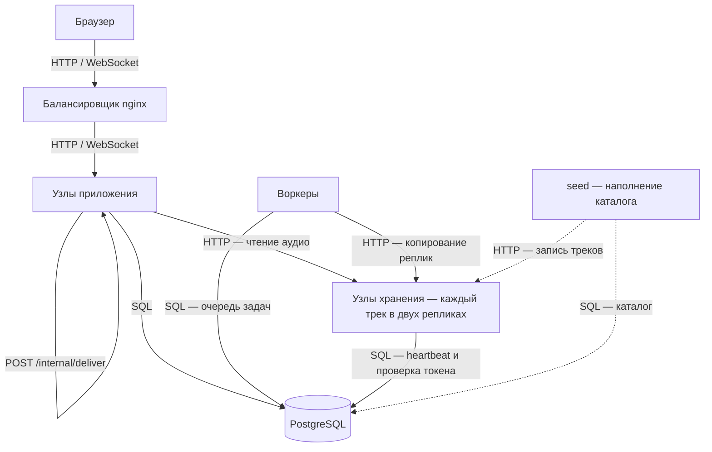
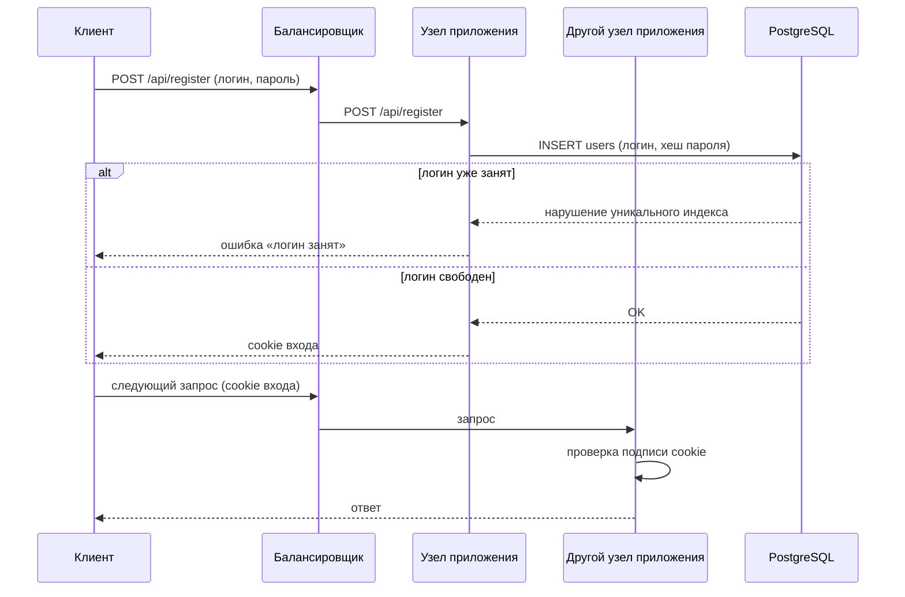
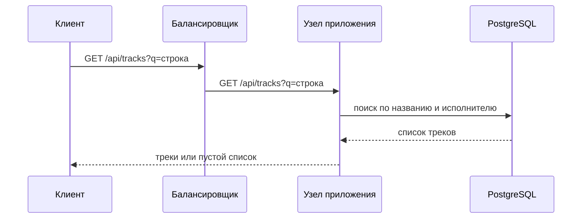
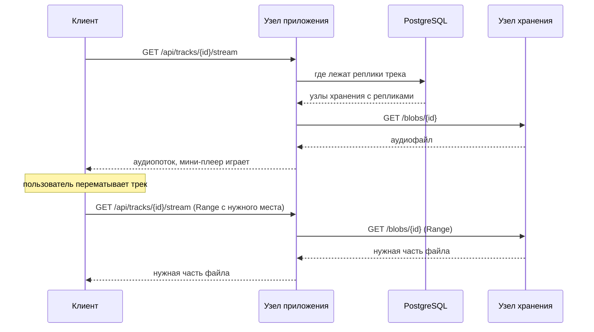
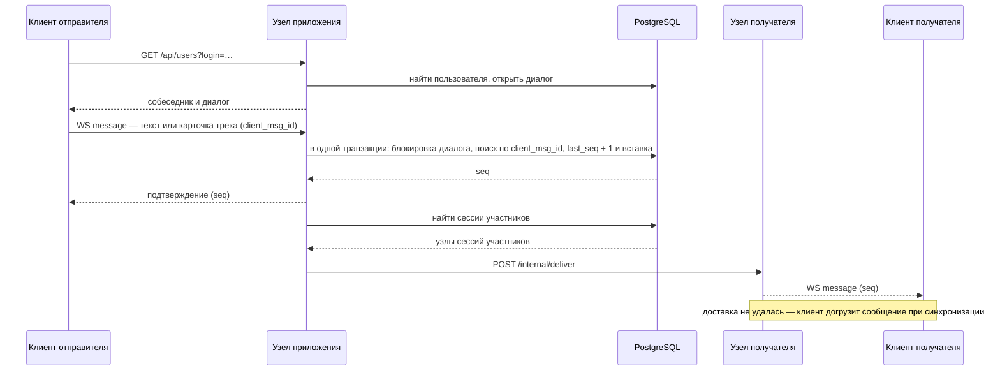
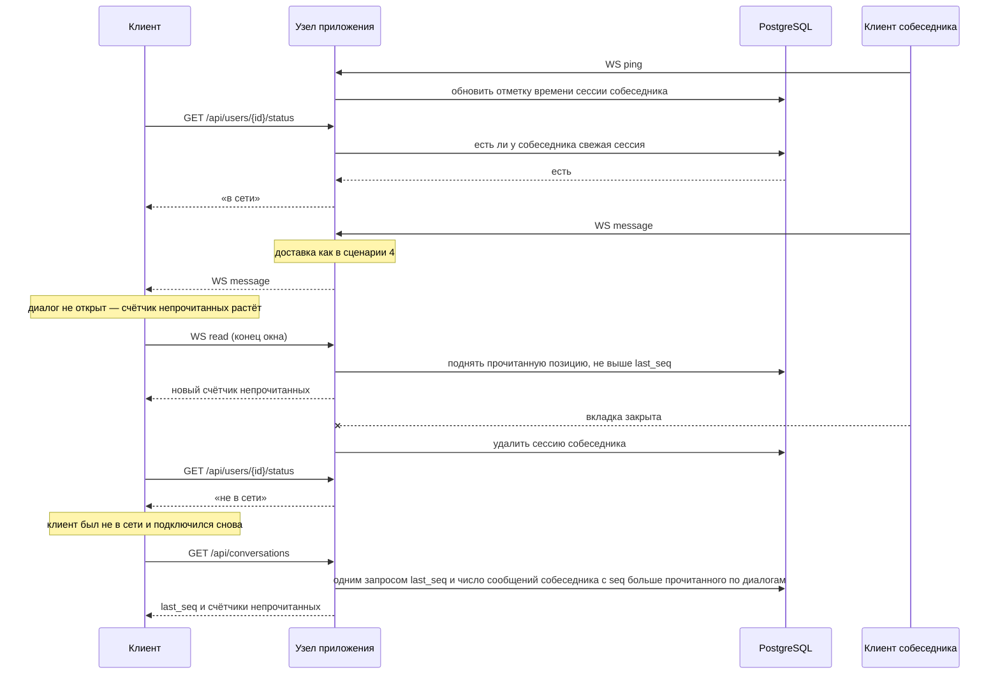
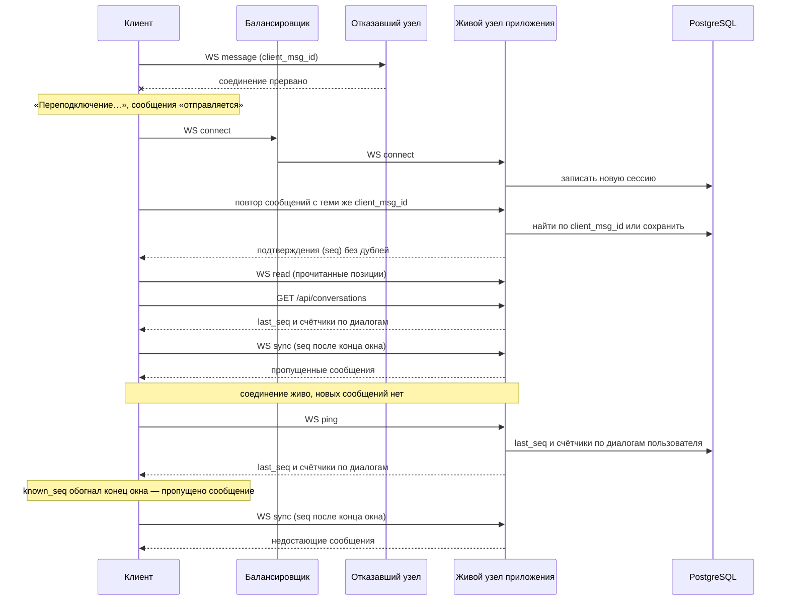
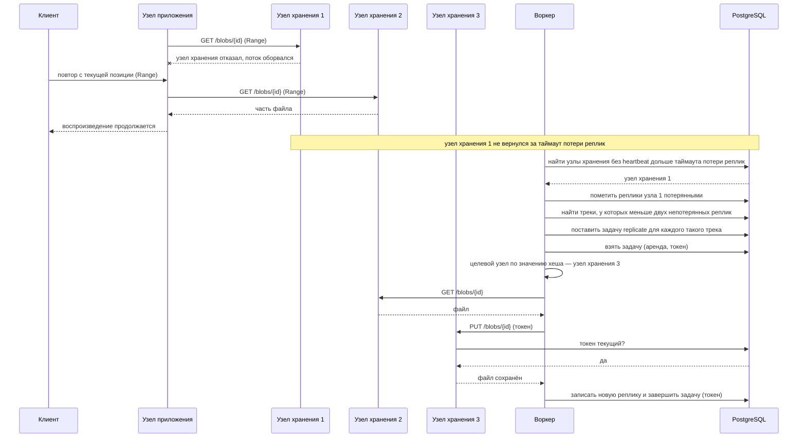
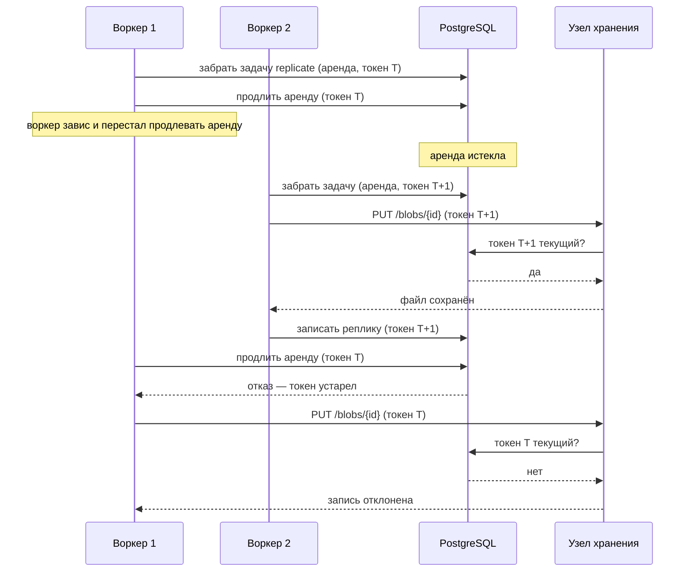

# Техническое решение проекта «Музыкальный мессенджер»

## Введение

- **Цель проекта:**  
  Реализовать прототип распределённой системы, в которой пользователи слушают треки, переписываются и отправляют треки друг другу в чат. Система работает на нескольких узлах, хранит каждый аудиофайл в двух копиях и продолжает работать при отказе отдельных узлов.

- **Задачи:**
  1. Реализовать мессенджер с обменом треками, работающий на нескольких узлах приложения.
  2. Обеспечить доставку сообщений между узлами без потерь, дублей и с одинаковым порядком у всех участников.
  3. Реализовать собственное реплицированное хранилище аудиофайлов и собственную очередь задач, которые переживают отказ отдельных узлов.
  4. Закрепить на практике решения проблем распределённых систем: ненадёжной доставки, частичных отказов, распределения данных, согласованности и порядка событий.

- **Основания для разработки:**  
  Учебный групповой проект по курсу «Основы распределённых вычислений», СПбГУ, 2026 г.

- **Команда:**

| Участник | Роль |
|---|---|
| Григорьев Павел | Backend-разработчик |
| Бызов Дмитрий | Fullstack-разработчик |
| Иванов Олег | Team Lead, Frontend-разработчик |
| Еременко Артем | DevOps, тестировщик |

---

## Глоссарий
| Термин | Определение |
|---|---|
| Пользователь | Зарегистрированный клиент системы |
| Трек | Аудиофайл в формате MP3 с названием, исполнителем и длительностью |
| Диалог | Переписка двух пользователей |
| Карточка трека | Сообщение в диалоге, из которого собеседник запускает трек |
| Узел | Общее название любой части системы, которая работает в отдельном процессе и может отказать независимо от остальных. |
| Узел приложения | Вид узла: копия веб-приложения, которая обслуживает запросы пользователей. Таких узлов несколько, и они взаимозаменяемы |
| Узел хранения | Вид узла: хранит аудиофайлы на собственном диске |
| Воркер | Вид узла: выполняет фоновые задачи, например восстановление недостающих реплик |
| Реестр узлов | Таблица в БД, где узлы регистрируются и регулярно отправляют heartbeat — отметку «я жив» |
| Реплика | Копия трека на одном из узлов хранения. Каждый трек хранится в двух репликах |
| Хеш | Число, которое хеш-функция вычисляет по любым данным. Для одних и тех же данных хеш всегда одинаков, а для разных выглядит случайным и равномерно разбросан |
| Хеш-партиционирование | Способ распределять данные по узлам: узел для каждого объекта вычисляется по хешу его ключа, поэтому любой участник получает один и тот же ответ без согласования с остальными |
| Сессия | Запись о том, к какому узлу приложения подключён пользователь. Сессия считается свежей, пока клиент регулярно отправляет ping |
| seq | Порядковый номер сообщения в диалоге; номера идут без пропусков |
| last_seq | Счётчик в строке диалога — `seq` последнего сообщения. Увеличивается в одной транзакции с сохранением нового сообщения |
| known_seq | Наибольший `seq` диалога, о котором знает клиент. Только растёт |
| client_msg_id | Уникальный идентификатор, который клиент присваивает сообщению перед отправкой. По нему сервер распознаёт повторную отправку |
| Атомарная операция | Операция, которая либо выполняется целиком, либо не выполняется вовсе; промежуточное состояние никому не видно |
| Идемпотентность | Свойство операции: повторное выполнение даёт тот же результат, что и однократное |
| Аренда (lease) | Временное право воркера на задачу. Пока воркер работает, он продлевает аренду; когда аренда истекает, задачу может забрать другой воркер |
| Токен ограждения | Номер попытки выполнения задачи. Результат воркера с устаревшим токеном отклоняется |

---

## Функциональные требования
Система должна предоставлять следующие функции:
1. Регистрация и вход по логину и паролю.
2. Каталог треков и поиск по названию и исполнителю.
3. Прослушивание трека с перемоткой. Воспроизведение не прерывается при переходе между разделами.
4. Личные сообщения с любым пользователем и история диалога.
5. Отправка трека в чат карточкой, которую собеседник запускает прямо из диалога.
6. Онлайн-статус собеседника и счётчик непрочитанных сообщений.

---

## Нефункциональные требования
1. **Отказоустойчивость:** при отказе одного узла приложения, одного узла хранения или одного воркера система продолжает работать. После потери соединения клиент подключается заново автоматически.
2. **Надёжность:** подтверждённое сообщение не теряется при отказе узла приложения. Фоновая задача не теряется при отказе воркера и выполняется другим воркером.
3. **Согласованность:** повторная отправка сообщения не создаёт дубль. Порядок сообщений в диалоге одинаков у всех участников, даже если они подключены к разным узлам приложения.
4. **Распределённое хранение:** каждый трек хранится в двух репликах на разных узлах хранения. После отказа узла хранения недостающая реплика восстанавливается автоматически.
5. **Масштабируемость:** система работает с несколькими узлами приложения. Любой запрос может обработать любой живой узел, а новый узел подключается без изменения кода и конфигурации.
6. **Безопасность:** пароли хранятся в виде хеша, взаимодействие между узлами закрыто для внешних запросов.
7. **Развёртывание:** вся система запускается одной командой `docker compose up`.
8. **Ограничения технологий:** не используются готовые распределённые решения (Spark, Cassandra, K8S и другие). PostgreSQL работает в одном экземпляре, без репликации.

---

## Пользовательские сценарии

### Сценарий 1. Регистрация и вход
1. Пользователь открывает сайт и регистрируется, указав логин и пароль.
2. Если логин уже занят, система сообщает об этом и просит выбрать другой.
3. После регистрации пользователь попадает в раздел «Музыка».
4. В следующий раз пользователь входит с тем же логином и паролем. При неверном пароле он видит ошибку.

### Сценарий 2. Найти трек в каталоге
1. Пользователь открывает раздел «Музыка» и видит каталог треков.
2. Пользователь вводит в поиск часть названия или имени исполнителя.
3. Система показывает подходящие треки, а если ничего не найдено — сообщает об этом.

### Сценарий 3. Послушать трек
1. Пользователь нажимает «▶» у трека — трек начинает играть в мини-плеере внизу экрана.
2. Пользователь перематывает трек на нужное место.
3. Пользователь переходит в раздел «Чаты» — музыка не прерывается.

### Сценарий 4. Переписка
1. Алиса находит Боба по логину и открывает диалог с ним.
2. Алиса пишет и отправляет сообщение.
3. Сообщение появляется в диалоге у Алисы и у Боба.
4. Позже Боб открывает диалог и видит всю историю переписки; более старые сообщения подгружаются при прокрутке.

### Сценарий 5. Поделиться треком
1. Алиса нажимает «Отправить в чат» у трека и выбирает Боба.
2. У Боба растёт счётчик непрочитанных в диалоге с Алисой.
3. Боб открывает диалог и видит карточку трека.
4. Боб нажимает «▶» на карточке, и трек играет у него.

### Сценарий 6. Онлайн-статус и непрочитанные
1. Алиса открывает диалог с Бобом и видит, что Боб в сети.
2. Пока Алиса находится в другом диалоге, Боб отправляет ей сообщение — у диалога с Бобом появляется счётчик непрочитанных.
3. Алиса открывает диалог с Бобом — счётчик обнуляется.
4. Боб закрывает вкладку — через некоторое время Алиса видит, что Боб не в сети.

### Сценарий 7. Потеря соединения
1. Соединение Боба с сервером прерывается: сервер упал или пропала сеть.
2. Боб видит «Переподключение…», а сообщения, которые он отправляет в это время, помечены как «отправляется».
3. Когда связь восстанавливается, клиент сам подключается к доступному узлу приложения.
4. Неотправленные сообщения Боба уходят собеседнику, а сообщения, пришедшие за это время, появляются в диалоге — без потерь и дублей.

---

## Архитектура системы

Основные компоненты:

1. Балансировщик (nginx) — единственная входная точка: распределяет HTTP-запросы и WebSocket-подключения по живым узлам приложения и не пропускает снаружи запросы к внутренним адресам `/internal/*`. Узлы приложения он находит по имени сервиса через встроенный DNS Docker и регулярно обновляет список их адресов, поэтому новый узел начинает получать запросы без изменения конфигурации.
2. Узел приложения (FastAPI) — страницы и API, WebSocket-подключения, выдача аудио. Сообщения для пользователей, подключённых к другим узлам, пересылает через внутренний запрос `POST /internal/deliver`. Узлов несколько, они взаимозаменяемы.
3. Узел хранения — хранит аудиофайлы на своём диске и работает с ними по HTTP: `GET /blobs/{id}` отдаёт файл (с заголовком `Range` — только нужную часть), `PUT /blobs/{id}` сохраняет файл атомарно — во временный файл с уникальным именем с последующим переименованием; запись по задаче воркера с устаревшим токеном ограждения отклоняется. Узлов не меньше трёх, каждый трек лежит на двух из них.
4. Воркер — выполняет фоновые задачи, прежде всего восстановление реплик. Воркеров не меньше двух.
5. PostgreSQL — пользователи, сообщения, каталог и расположение реплик, сессии, реестр узлов, очередь задач.
6. Наполнение каталога (`seed`) — при развёртывании загружает подготовленный набор треков; повторный запуск не создаёт дублей.

### Взаимозаменяемые узлы приложения

- **Проблема:** если узел хранит состояние у себя, пользователя может обслужить только «его» узел, и отказ узла обрывает работу.
- **Решение:** узлы приложения не хранят постоянного состояния: всё, кроме открытых WebSocket-подключений, лежит в PostgreSQL. Балансировщик находит узлы приложения через DNS Docker. Вход подтверждает cookie, подписанная общим ключом узлов, а подключения пользователей записаны в таблицу `sessions`.
- **Гарантия:** любой запрос обрабатывает любой живой узел; новый узел подключается без изменения кода и конфигурации.
- **Компромиссы:** вся работа с данными идёт через один экземпляр PostgreSQL.

### Обнаружение отказов

- **Проблема:** узел может отказать «молча».
- **Решение:** узлы регулярно отправляют heartbeat в реестр узлов; узел без heartbeat дольше таймаута считается отказавшим.
- **Гарантия:** отказавшему узлу не пересылают сообщения и не размещают на нём новые реплики.
- **Компромиссы:** короткий таймаут принимает медленный узел за отказавший, длинный замедляет реакцию на отказ.

### Доставка сообщений и идемпотентность

- **Проблема:** узел может упасть во время пересылки сообщения, а клиент — повторить отправку после обрыва связи.
- **Решение:** сообщение сохраняется в PostgreSQL до подтверждения отправителю и рассылается во все сессии обоих участников диалога. Клиент повторяет неподтверждённые сообщения с тем же `client_msg_id`; повтор узел ищет под блокировкой строки диалога ещё до выдачи номера, поэтому он не создаёт дубль и не расходует `seq`. Сообщение, пересылка которого не удалась, клиент получит при синхронизации истории.
- **Гарантия:** подтверждённое сообщение не теряется и в итоге доходит до получателя, повторная отправка не создаёт дубль.
- **Компромиссы:** если пересылка не удалась, получатель увидит сообщение только при синхронизации — не позже следующей сверки.

### Порядок сообщений

- **Проблема:** участники пишут в один диалог одновременно через разные узлы.
- **Решение:** `seq` — это счётчик `last_seq` в строке диалога: в одной транзакции со вставкой сообщения его увеличивают на единицу, а блокировка строки держится до коммита. Поэтому номера в диалоге идут без пропусков, а сообщения фиксируются строго в порядке номеров. Клиент показывает сообщения по `seq`.
- **Гарантия:** порядок сообщений в диалоге одинаков у всех участников.
- **Компромиссы:** одновременные отправки в один диалог выполняются по очереди.

### Синхронизация истории на клиенте

- **Проблема:** пересылка может не дойти или прийти через пропуск, а клиент держит в памяти только часть истории. Нужно не потерять ни одного сообщения и не пометить прочитанным сообщение, которого у клиента ещё нет.
- **Решение:** для каждого диалога клиент хранит `known_seq` и окно.
  - `known_seq` клиент поднимает по списку диалогов, ответу на ping, доставленному сообщению и подтверждению своего сообщения.
  - Диалог открывается с последних сообщений. Окно растёт вверх порциями истории при прокрутке и вниз — следующим по номеру сообщением, полученным или своим подтверждённым.
  - Как только `known_seq` обгоняет конец окна — пришло сообщение через пропуск или сверка показала больший `last_seq`, — клиент догружает сообщения после конца окна.
  - Сверка: в ответ на ping узел одним запросом возвращает для каждого диалога `last_seq` и счётчик непрочитанных — так же, как список диалогов.
  - Если сообщение или сверка относится к незнакомому диалогу, клиент перезагружает список диалогов. Перезагрузка добавляет незнакомые диалоги и поднимает `known_seq` известных, но окна не трогает. Повторно полученное сообщение клиент узнаёт по `seq`.
- **Гарантия:** в окне нет пропусков, а о каждом новом сообщении клиент узнаёт не позже следующей сверки, поэтому история у участников сходится к одной и той же.
- **Компромиссы:** каждая сверка — запрос к PostgreSQL по всем диалогам пользователя; сообщение, потерянное при пересылке, появляется с задержкой до следующей сверки; при открытии диалога прочитанными становятся все сообщения до последнего, даже если пользователь не долистал до них.

### Распределение треков по узлам хранения

- **Проблема:** треки нужно разложить по узлам хранения равномерно, а любой воркер должен одинаково определять, куда положить новую реплику, не договариваясь с остальными.
- **Решение:** хеш-партиционирование по `id` трека. Для каждого узла хранения вычисляется хеш от пары «`id` трека, `id` узла», и трек хранится на двух живых узлах с наибольшими значениями хеша. Ключом выбран `id` трека: он не меняется и известен в каждом запросе.
- **Гарантия:** треки распределяются по узлам примерно поровну, а размещение любой узел вычисляет одинаково, не обращаясь к другим. При отказе узла меняется размещение только тех треков, которые на нём лежали.
- **Компромиссы:** при добавлении нового узла хранения уже размещённые треки на него не переносятся.

### Реплицированное хранилище треков

- **Проблема:** узел хранения может отказать вместе с диском.
- **Решение:** каждый трек записывается на два узла хранения, выбранных по хешу; фактическое расположение реплик хранится в таблице `replicas`. Аудио отдаётся с любой живой реплики, а недостающую реплику воркер создаёт на живом узле со следующим по величине значением хеша.
- **Гарантия:** при отказе одного узла хранения треки остаются доступны, вторая реплика восстанавливается автоматически.
- **Компромиссы:** треки занимают вдвое больше места; до восстановления трек хранится в одной копии.

### Очередь задач: аренда и токен ограждения

- **Проблема:** воркер может упасть или зависнуть посреди задачи, а очнувшись — продолжить работу, хотя задачу уже забрал другой.
- **Решение:** задачи лежат в таблице `jobs`, одна и та же задача не ставится дважды. Воркер берёт задачу с короткой арендой и, пока работает, регулярно продлевает её, сверяя токен ограждения; если продлить не удалось, он прекращает работу. Узел хранения перед сохранением файла сверяет токен в PostgreSQL и отклоняет запись с устаревшим, а изменения каталога реплик в БД принимаются только с текущим токеном. Файл трека после записи не меняется и сохраняется атомарно.
- **Гарантия:** задача не теряется и может длиться сколько угодно; каталог реплик меняет только воркер с текущим токеном. Запоздалая запись файла, проскочившая между проверкой токена и сохранением, лишь повторно записывает те же данные.
- **Компромиссы:** после отказа воркера задача ждёт, пока истечёт аренда; запоздалая запись может оставить на узле хранения лишнюю копию файла, которой нет в каталоге реплик.

**Ограничения архитектуры:** PostgreSQL и балансировщик работают в одном экземпляре и остаются единственными точками отказа; все узлы запускаются на одной машине под Docker Compose.

Технологии: Python 3.12, FastAPI, PostgreSQL, Jinja2 + HTMX, nginx, Docker Compose, pytest.

---

## Технические сценарии

### Сценарий 1. Регистрация и вход

1. Клиент отправляет логин и пароль через `POST /api/register`, балансировщик передаёт запрос любому живому узлу приложения.
2. Узел приложения хеширует пароль и сохраняет пользователя в PostgreSQL. Если логин уже занят, уникальный индекс не даёт создать второго пользователя, и клиент получает ошибку.
3. Узел выдаёт клиенту cookie входа, подписанную общим ключом узлов приложения.
4. Следующие запросы клиента может обработать любой узел: он сам проверяет подпись cookie.
5. При входе через `POST /api/login` узел сверяет пароль с хешем из PostgreSQL и при совпадении выдаёт новую cookie входа.
6. Пользователь может работать сразу в нескольких вкладках и браузерах. Все вкладки одного браузера отправляют одну и ту же cookie, поэтому входить в каждой заново не нужно; в другом браузере или на другом устройстве пользователь входит отдельно и получает свою cookie. Каждая вкладка открывает своё WebSocket-подключение, и для неё создаётся своя сессия.

### Сценарий 2. Поиск трека

1. Клиент отправляет `GET /api/tracks?q=…` с частью названия или имени исполнителя.
2. Балансировщик передаёт запрос любому живому узлу приложения.
3. Узел приложения ищет совпадения по названию и исполнителю в PostgreSQL без учёта регистра.
4. Узел возвращает найденные треки. Если ничего не найдено, клиент сообщает об этом пользователю.

### Сценарий 3. Воспроизведение трека

1. Пользователь нажимает «▶» у трека в каталоге или на карточке в диалоге, и клиент запрашивает трек через `GET /api/tracks/{id}/stream`; балансировщик передаёт запрос любому живому узлу приложения.
2. Узел приложения находит в PostgreSQL, на каких узлах хранения лежат реплики трека, и выбирает живой узел.
3. Узел приложения читает файл с этого узла хранения и передаёт его клиенту по частям; мини-плеер начинает играть.
4. При перемотке клиент запрашивает файл с нужного места (заголовок `Range`), и узел приложения передаёт только эту часть.
5. Мини-плеер находится в части страницы, которая не меняется при переходе между разделами, поэтому музыка не прерывается.

### Сценарий 4. Сообщение пользователю на другом узле

1. Клиент находит собеседника по логину через `GET /api/users?login=…`, и узел приложения открывает с ним диалог — существующий или новый. Уникальный индекс по паре пользователей не даёт создать второй диалог: если оба открывают диалог одновременно через разные узлы, второй запрос находит диалог, созданный первым.
2. Клиент отправляет по WebSocket сообщение — текст или карточку трека — с уникальным `client_msg_id`.
3. Узел приложения в одной транзакции блокирует строку диалога и ищет сообщение с этим `client_msg_id`. Если его нет, узел увеличивает счётчик `last_seq` и сохраняет сообщение с этим номером как `seq`; если есть — возвращает уже сохранённое, и номер не расходуется. Два одновременных повтора через разные узлы встают в очередь на блокировке, и второй находит сообщение первого.
4. Узел по таблице `sessions` определяет, к каким узлам приложения подключены участники диалога: у каждого может быть несколько сессий, по одной на вкладку. Сообщение рассылается во все сессии обоих участников, в том числе в другие вкладки отправителя.
5. Сессиям на других узлах сообщение передаётся через `POST /internal/deliver`.
6. Узлы доставляют сообщение клиентам. Если доставка не удалась, клиент узнает о сообщении при синхронизации истории: по пропуску в номерах или при ближайшей сверке.

### Сценарий 5. Онлайн-статус и непрочитанные

1. Клиент собеседника регулярно отправляет ping по WebSocket, и узел приложения обновляет отметку времени его сессии.
2. Клиент запрашивает статус собеседника. Узел проверяет, есть ли у собеседника свежая сессия на живом узле, и отвечает «в сети» или «не в сети».
3. Клиент в сети, но у него открыт другой диалог. Собеседник присылает сообщение, оно доставляется как в сценарии 4: `known_seq` диалога растёт, и клиент прибавляет единицу к счётчику непрочитанных. Точное значение счётчика клиент получает с сервера — в списке диалогов, в ответе на ping и в ответе на отметку прочтения, поэтому расхождения, например из-за другой вкладки, исправляются сами.
4. Клиент открывает этот диалог с последних сообщений, а более старые подгружает при прокрутке вверх. Прочитанным клиент сообщает конец окна — последнее сообщение, которое у него есть: окно непрерывно, поэтому позиция не перепрыгнет через пропущенное сообщение. Пока диалог открыт, клиент сообщает позицию каждый раз, когда окно растёт, и повторяет её после переподключения. Узел принимает позицию только от участника диалога, не больше `last_seq` диалога и только если она больше сохранённой, и в ответ сообщает новое значение счётчика — при открытии диалога он обнуляется.
5. Если клиент был не в сети или страницу перезагрузили, после подключения клиент загружает список диалогов: узел одним запросом возвращает для каждого диалога `last_seq` и счётчик непрочитанных — число сообщений собеседника с `seq` больше последнего прочитанного. Собственные сообщения пользователя в счётчик не входят. Между сессиями клиент ничего не хранит.
6. Собеседник закрывает вкладку, узел удаляет его сессию, и на следующий запрос статуса клиент получает «не в сети». Если отказал сам узел собеседника, сессия перестаёт быть свежей без ping.

### Сценарий 6. Потеря соединения

1. Соединение клиента с узлом приложения прерывается. Клиент показывает «Переподключение…», а новые сообщения помечает как «отправляется».
2. Клиент подключается заново, и балансировщик направляет его на живой узел приложения.
3. Клиент повторяет отправку неподтверждённых сообщений с теми же `client_msg_id`. Если сообщение уже было сохранено, узел возвращает его, не создавая дубль.
4. Клиент повторяет прочитанные позиции и перезагружает список диалогов: `known_seq` и счётчики обновляются, окна остаются на месте. Если `known_seq` обогнал конец окна открытого диалога, клиент догружает сообщения после конца окна; уже показанные он узнаёт по `seq`.
5. Пока соединение живо, клиент сверяется регулярно: в ответ на ping узел возвращает `last_seq` и счётчик непрочитанных каждого диалога. Так находится и потерянное последнее сообщение, после которого новых не было.
6. Когда истекает таймаут heartbeat, отказавший узел перестаёт учитываться при доставке сообщений.

### Сценарий 7. Отказ узла хранения

1. Во время воспроизведения узел хранения, с которого узел приложения читает файл, отказывает, и поток обрывается.
2. Клиент повторяет запрос с текущей позиции (заголовок `Range`).
3. Узел приложения берёт вторую реплику трека на другом узле хранения, и воспроизведение продолжается.
4. Каждый воркер регулярно проверяет реплики. Сначала он находит в реестре узлов узлы хранения, от которых нет heartbeat дольше таймаута потери реплик, и помечает все их записи в таблице `replicas` потерянными.
5. Затем воркер одним запросом к PostgreSQL находит треки, у которых в `replicas` осталось меньше двух записей, не помеченных потерянными, и для каждого такого трека ставит в очередь задачу `replicate`. Для одного трека задача не ставится дважды, поэтому проверки, запущенные разными воркерами одновременно, не создают дублей.
6. Задачу забирает любой свободный воркер — с арендой и токеном ограждения, как в сценарии 8. Целевой узел — живой узел хранения с наибольшим значением хеша для этого трека, на котором трека ещё нет; источник — уцелевшая реплика.
7. Воркер читает файл с уцелевшей реплики и передаёт его целевому узлу вместе с токеном ограждения. Узел хранения сверяет токен в PostgreSQL и сохраняет файл, после чего воркер записывает новую реплику в `replicas` и отмечает задачу выполненной.

### Сценарий 8. Отказ воркера во время задачи

1. Воркер забирает задачу `replicate` с короткой арендой и токеном ограждения и, пока копирует файл, регулярно продлевает аренду, сверяя токен.
2. Воркер падает или зависает и перестаёт продлевать аренду.
3. Аренда истекает, задачу забирает другой воркер, и токен ограждения увеличивается.
4. Новый воркер копирует файл, передавая узлу хранения свой токен. Узел хранения сверяет токен в PostgreSQL и сохраняет файл, после чего воркер записывает реплику в БД с тем же токеном.
5. Если первый воркер очнётся, продлить аренду ему не удастся, и он прекратит работу. Если он успеет отправить файл, узел хранения отклонит запись со старым токеном. Если же запись проскочит между проверкой токена и сохранением, она лишь повторно запишет те же данные: файл трека не меняется и сохраняется атомарно. Изменить каталог реплик со старым токеном первый воркер не сможет.

---

## План разработки и тестирования

**План разработки:**
1. Схема БД и общие форматы: WebSocket-события, API узла хранения, `/internal/deliver`, задачи очереди
2. Docker Compose, nginx и миграции
3. Реестр узлов и обнаружение отказов
4. Узел хранения и наполнение каталога
5. Регистрация и вход, каталог, поиск и воспроизведение
6. Диалоги, сообщения и межузловая доставка
7. Интерфейс и WebSocket-клиент с переподключением
8. Онлайн-статус и непрочитанные
9. Очередь задач, воркер и восстановление реплик

**План тестирования:**
- Модульные тесты: выдача `seq`, идемпотентная отправка, захват задачи и токен ограждения, выбор узлов для реплик
- Интеграционные тесты через HTTP и WebSocket: вход, поиск, воспроизведение, переписка, онлайн-статус
- Тест одновременной отправки в один диалог через разные узлы
- Тест добавления нового узла приложения
- Проверка безопасности: `/internal/*` недоступен снаружи, пароли в БД хранятся только хешами
- Проверка граничных случаев: занятый логин, неверный пароль, пустой результат поиска

**Definition of Done (DoD):**
- Пользователь регистрируется и входит по логину и паролю; при занятом логине и неверном пароле видит ошибку
- Пользователь видит каталог треков и находит трек по названию или исполнителю
- Трек воспроизводится и перематывается, музыка не прерывается при переходе между разделами
- Пользователь находит собеседника по логину, переписывается с ним и видит историю диалога
- Пользователь отправляет трек в чат карточкой, и собеседник запускает его прямо из диалога
- Пользователь видит онлайн-статус собеседника и счётчик непрочитанных сообщений